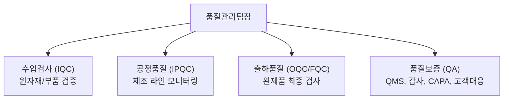

# 01. 팀 소개 및 역할 (Team Overview & R&R)

품질관리팀은 고객에게 최고 수준의 제품과 신뢰를 전달하기 위한 사내 최후의 방어선이자 개선의 출발점입니다.

---

## 1. 팀의 미션 및 핵심 가치

- **미션 (Mission):** 엄격한 품질 기준과 체계적인 데이터 기반 검증을 통해 불량의 유출을 원천 차단하고 제품 신뢰도를 극대화한다.
- **핵심 가치 (Core Values):**
  1. **원칙 준수 (Integrity):** 타협하지 않는 표준 준수 및 정직한 데이터 기록
  2. **예방 우선 (Prevention):** 발생 후 조치보다 사전 검증 및 공정 모니터링을 통한 불량 예방
  3. **데이터 중심 (Fact-based):** 추측이 아닌 통계와 측정 데이터에 기반한 문제 해결

---

## 2. 조직 구성 및 직무별 R&R (역할과 책임)

품질관리팀은 세부 기능에 따라 다음과 같이 구분되며 상호 긴밀하게 협력합니다.

### 1) 수입검사 (IQC - Incoming Quality Control)
- 원부자재, 외주 가공품 입고 시 규격 및 도면 적합성 검사
- 원자재 성적서(COA/Mill Sheet) 검토 및 보관
- 협력사 수입 불량 발생 시 반품 처리 및 개선 요구

### 2) 공정품질 (IPQC - In-Process Quality Control)
- 제조 라인 초/중/종물 검사 및 공정 순회 검사
- 작업 표준 준수 여부 및 4M(Man, Machine, Material, Method) 변경점 관리
- 공정 이상 발생 시 라인 인터락(Line Stop) 및 원인 조사 지원

### 3) 출하/최종검사 (OQC/FQC - Outgoing / Final Quality Control)
- 포장 완료된 완제품의 외관, 기능, 포장 상태 샘플링 검사
- 출하 승인 및 출하검사 성적서 발행
- 고객사 요구 조건(라벨링, 팔레트 적재 등) 검증

### 4) 품질보증 및 시스템 (QA - Quality Assurance)
- 사내 품질경영시스템(ISO, 규제 요구사항) 유지 및 관리
- 고객사 클레임 접수 및 8D Report/CAPA 작성 및 사후 유효성 검증
- 사내/외 품질 감사(Internal/External Audit) 주관

---

## 3. 유관 부서와의 협업 관계

| 부서 | 주요 협업 내용 | 커뮤니케이션 채널 |
| :--- | :--- | :--- |
| **생산팀** | 공정 불량 즉시 공유, 초중종물 검사, 라인 트러블 개선 | 사내 메신저(#prod-qc), 일일 생산/품질 미팅 |
| **연구/개발팀** | 도면 공차 검토, 양산 전 초도품 검사(PPAP), 설계 변경 검증 | 품질회의, JIRA/협업툴 |
| **구매/자재팀** | 협력사 품질 이슈 피드백, 자재 입고 스케줄 조율, 반품 처리 | 이메일, ERP 수입검사 모듈 |
| **영업/CS팀** | 고객 클레임 분석 지원, 고객사 제출용 성적서 발행 | CS 이슈 티켓 시스템 |

---

## 4. 첫 30일 온보딩 로드맵 (Checklist)

### 1주차: 환경 적응 및 기초 이해
- [ ] 사내 계정 및 주요 시스템 권한 획득 (ERP, MES, 사내 위키 등)
- [ ] 품질관리팀 문서 보관 위치 및 파일 서버 경로 확인
- [ ] 생산 현장 및 검사실 투어 (비상구, 안전 보호구 착용 위치 파악)
- [ ] 사내 품질 방침 및 팀 내규 숙독

### 2주차: 기본 표준 및 규격 학습
- [ ] 취급 제품군 리스트 및 부품 도면/스펙북 열람
- [ ] 담당 파트(IQC/IPQC/OQC) 표준 작업 지침서(SOP) 학습
- [ ] 선임 검사원의 검사 작업 쉐도잉(Shadowing) 동행
- [ ] 검사 성적서 템플릿 및 입력 시스템 사용법 실습

### 3주차: 실무 기초 실습 (멘토 지도)
- [ ] 주요 측정 장비(버니어캘리퍼스, 마이크로미터 등) 기본 조작 및 게이지 점검
- [ ] 샘플 검사 직접 수행 및 멘토 피드백 수렴
- [ ] 부적합품 발생 시 식별/격리 절차 실습
- [ ] 일일 검사 일지 작성 및 시스템 등록 실습

### 4주차: 독립 업무 수행 및 중간 점검
- [ ] 담당 공정/품목에 대한 단독 검사 진행 (멘토 최종 확인)
- [ ] 발생 가능한 이슈 상황(불량 판정 등) 대처 시뮬레이션
- [ ] 1개월 차 온보딩 회고 및 팀장 면담
