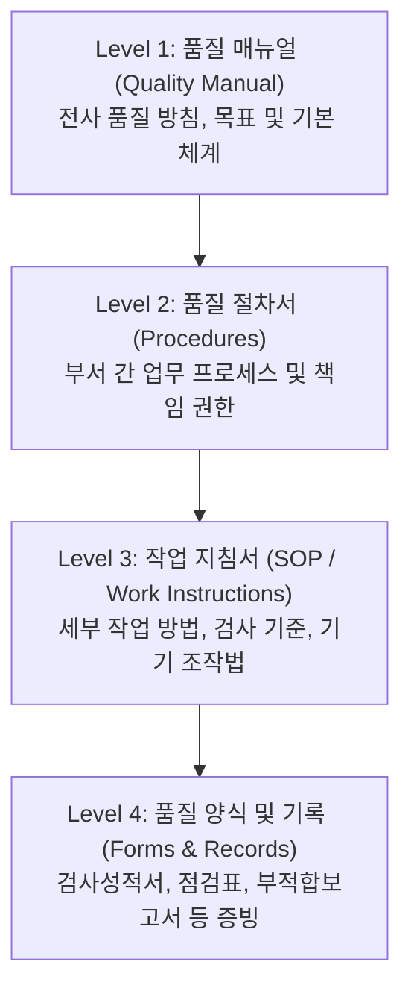

# 02. 사내 품질 시스템 및 규정 (QMS & Standards)

품질관리 업무는 주관적인 판단이 아닌 명문화된 사내 규정과 국제 표준 규격에 따라 일관되게 수행되어야 합니다.

---

## 1. 사내 품질경영시스템 (QMS) 개요

당사의 품질경영시스템은 국제 표준 인증(예: ISO 9001 / ISO 13485 / IATF 16949)을 준수하며 다음과 같은 계층 구조로 이루어져 있습니다.

---

## 2. 문서 및 데이터 관리 원칙

### 1) ALCOA+ 원칙 (데이터 완전성)
품질 데이터는 언제나 다음 원칙을 준수해야 합니다:
- **Attributable (귀속성):** 누가 기록했는지 명확해야 함 (서명/ID 기록)
- **Legible (판독성):** 누구나 읽을 수 있는 명확한 글씨와 형식
- **Contemporaneous (동시성):** 작업 수행 즉시 실시간으로 기록 (사후 소급 작성 절대 금지)
- **Original (원본성):** 가공되지 않은 1차 원본 보존
- **Accurate (정확성):** 거짓 없는 진실된 측정값 기입 (오기 시 취소선 긋고 서명 및 날짜 기재)

### 2) 문서 제정 및 개정 절차
1. **개정 필요성 발생:** 설계 변경, 규격 변경, 공정 개선 등
2. **초안 작성:** 담당자가 개정 사유와 전후 대비표 작성
3. **부서 협의 및 검토:** 생산, 개발, 기술팀 유관부서 회람
4. **품질부서 승인:** 품질책임자 최종 검토 및 서명
5. **배포 및 기존 본 회수:** 구버전 문서는 폐기 또는 `OBSOLETE(폐기)` 마킹 후 아카이빙
6. **현장 교육:** 개정된 SOP에 대해 현장 작업자/검사원 교육 후 교육일지 보관

---

## 3. 사내 주요 품질 문서 찾는 방법

- **사내 문서 관리 시스템 (EDMS / ERP 문서함):**
  - 접속 경로: 사내 인트라넷 > 품질경영시스템 > 규정/표준 검색
  - 분류 코드 예시:
    - `QM-001`: 품질 매뉴얼
    - `QP-XXX`: 품질 절차서 (예: QP-005 수입검사 절차서)
    - `WI-XXX`: 세부 작업지침서 (예: WI-QC-012 버니어캘리퍼스 측정 지침)
    - `QF-XXX`: 표준 양식 (검사성적서, 부적합통보서 등)
- **현장 비치본 관리:**
  - 생산/검사 구역에 비치된 모든 지침서 표지에는 반드시 **"관리본(CONTROLLED)"** 적색 스탬프가 찍혀 있어야 합니다. 비관리본은 참조용으로만 사용 가능하며 검사 기준으로 사용할 수 없습니다.

---

## 4. 품질 감사 (Audit) 대응 가이드

품질관리팀은 정기/수시로 진행되는 내/외부 감사의 중심 대응 조직입니다.

### 1) 감사의 종류
- **내부 감사 (Internal Audit):** 매년 정기적으로 사내 규정 준수 여부를 자체 점검
- **고객사 감사 (Customer Audit):** 주요 고객사로부터 공정 및 품질 시스템 심사
- **인증/규제기관 심사 (External Audit):** 인증기관(DNV, BSI 등) 갱신 심사 또는 관공서 정기 실사

### 2) 신규 담당자 심사 대응 수칙
1. **질문받은 내용만 명확히 답변:** 묻지 않은 내용이나 추측성 진술은 하지 않습니다.
2. **기록(객관적 증거)으로 증명:** "평소에 그렇게 하고 있습니다" 대신 "이 절차서와 해당 검사 기록을 확인해 주십시오"로 증명합니다.
3. **모르는 내용은 솔직히 확인 요청:** 확실하지 않은 절차는 "확인 후 바로 안내해 드리겠습니다"라고 정중히 답하고 선임/팀장에게 즉시 상의합니다.
