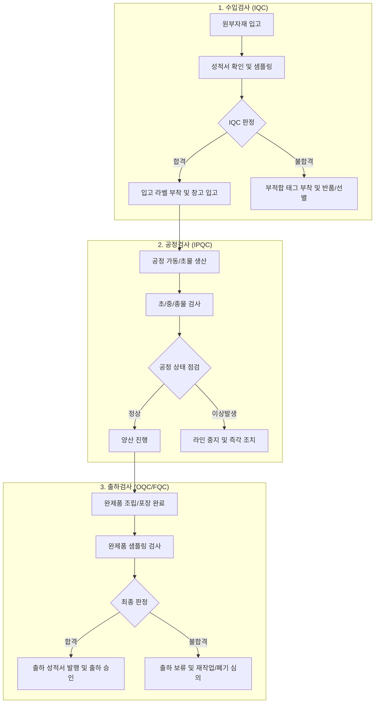

# 03. 검사 프로세스 및 실무 가이드 (Inspection Procedures)

품질 검사는 불량품이 다음 공정 또는 고객에게 유출되는 것을 차단하는 실무의 핵심 단계입니다.

---

## 1. 단계별 검사 프로세스

---

## 2. 샘플링 검사 기준 (AQL / KS Q ISO 2859-1)

전수 검사가 불가능한 품목은 국제 샘플링 검사 규격(KS Q ISO 2859-1 / MIL-STD-105E)에 따라 샘플링을 진행합니다.

### 1) 샘플링 수준 및 엄격도
- **통상 검사 수준:** 보통검사 수준 II (General Inspection Level II)를 기본으로 적용
- **검사 엄격도 전환 규칙:**
  - 연속 5로트 합격 시 $\rightarrow$ `수월한 검사(Reduced)` 전환 검토
  - 5로트 중 2로트 불합격 시 $\rightarrow$ `까다로운 검사(Tightened)` 즉시 전환

### 2) 결점 구분 및 AQL(합격품질수준) 설정 예시

| 결점 구분 | 정의 | 예시 | 통상 AQL |
| :--- | :--- | :--- | :---: |
| **치명 결점 (Critical)** | 안전상 위해를 끼치거나 법규 위반, 기본 기능 완전 상실 | 감전 위험, 독성 물질 함유, 누전, 화재 유발 | **0.0 (불허)** |
| **중결점 (Major)** | 제품 기능 저하, 수명 단축, 고객 사용 시 심각한 불편 초래 | 치수 공차 이탈로 조립 불가, 주요 센서 오작동 | **0.40 ~ 1.0** |
| **경결점 (Minor)** | 사용에는 지장 없으나 외관상 스크래치, 단순 라벨 부착 삐뚤어짐 | 미세 도장 불량, 비기능 부위 미세 찍힘 | **2.5 ~ 4.0** |

---

## 3. 검사 성적서 (Inspection Report / COA) 작성 요령

검사원은 검사 완료 후 반드시 정해진 양식에 따라 검사성적서를 작성하고 시스템(ERP/MES)에 승인 등록해야 합니다.

### 성적서 필수 기재 항목
1. **기본 정보:** 품번, 품명, 로트 번호(Lot No.), 입고/생산 수량, 검사일자, 검사원 성명
2. **도면/스펙 기준:** 검사 항목별 도면 규격치, 허용 공차 (상한 USL / 하한 LSL)
3. **측정 실측치:** 시료별 측정값 (최소 5개 시료 개별 기입 또는 Min/Max/Avg)
4. **사용 계측기 정보:** 계측기 명칭, 관리번호, 교정 유효기간
5. **최종 판정:** `합격(Accept)` / `불합격(Reject)` / `특채(Concession)`
6. **특이사항:** 결점 위치, 불량 발생 비율, 사진 첨부

---

## 4. 한도견본 (Limit Sample) 운용 지침

도면이나 수치로 정량화하기 어려운 외관(색상 편차, 스크래치 크기, Burr 등)은 한도견본을 기준으로 판정합니다.

- **한도견본의 관리:**
  - 합격 상한/하한 한도견본 각각 1세트 구비
  - 고객사 승인 날인 및 유효기간 라벨 부착 (통상 1년 단위 갱신)
  - 변색이나 마모를 방지할 수 있는 밀폐 케이스 보관
- **판정 원칙:**
  - 샘플이 한도견본의 불량 수준보다 심하면 즉시 불합격 처리
  - 경계선상의 애매한 샘플은 파트장/팀장 승인을 받거나 추가 샘플링 진행
