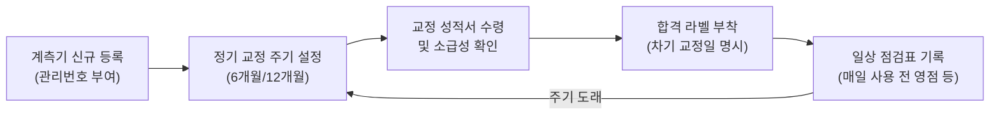

# 04. 품질 측정 장비 및 계측기 관리 (Equipment & Calibration)

정확한 측정 결과는 계측기의 주기적인 교정과 올바른 사용 습관에서 시작됩니다.

---

## 1. 주요 측정 장비 및 용도

| 장비명 | 측정 대상 | 측정 정밀도 | 주요 주의 사항 |
| :--- | :--- | :--- | :--- |
| **버니어 캘리퍼스 (디지털/아날로그)** | 외경, 내경, 깊이, 단차 | 0.01 mm | 조(Jaw) 이물질 확인, 영점 세팅, 과도한 압력 금지 |
| **마이크로미터 (외측/내측)** | 정밀 두께, 직경 | 0.001 mm (1 µm) | 래칫 스톱(Ratchet stop) 3회 클릭 소리 준수, 체온 영향 주의 |
| **하이트 게이지 (Height Gauge)** | 높이, 단차 | 0.01 mm | 정반(석정반) 평탄도 및 이물질 청결 유지 |
| **투영기 / 2차원 비접촉 측정기** | 미세 형상, 각도, 곡률 반경(R) | 1 µm | 렌즈 클리닝, 시료 수평 고정, 초점 정밀 조절 |
| **3차원 측정기 (CMM)** | 복잡한 입체 형상, 기하공차(GD&T) | 서브 마이크론 | 항온항습실(20±1°C) 유지, 프로브 캘리브레이션 필수 |
| **인장강도기 / 경도계** | 인장강도, 연신율, 로크웰/비커스 경도 | 시험별 규격 준수 | 시편 규격 준수, 지그 체결 상태 점검 |

---

## 2. 계측기 검교정 (Calibration) 관리 절차

모든 품질 검사 장비는 국가 공인 교정기관 또는 사내 표준기를 통해 정기적으로 교정을 받아야 합니다.

### 1) 교정 라벨 확인 수칙
- 검사 전 반드시 계측기 본체에 부착된 **녹색 교정 합격 라벨**을 확인하십시오.
- **교정 유효기간이 지난 계측기(적색 라벨 또는 만료)**는 절대로 검사에 사용해서는 안 되며, 즉시 계측기 담당자에게 반납하고 격리 보관해야 합니다.
- 교정 만료 장비로 검사한 이력이 발견될 경우 해당 기간 동안 출하/생산된 로트에 대한 전수 재검증 리스크가 발생합니다.

### 2) 계측기 일상 점검 (Daily Check)
- 검사 시작 전 정반 청소 및 표준 블록게이지(Gauge Block)를 이용한 영점 확인
- 배터리 잔량 및 디스플레이 깜빡임 유무 확인
- 일일 계측기 점검표(Checksheet)에 이상 유무 서명

---

## 3. 측정 시스템 분석 (MSA) 및 게이지 R&R

측정값의 오차는 제품 자체의 산포뿐 아니라 **측정자(재현성)**와 **계측기(반복성)**의 오차에서 발생할 수 있습니다.

- **Repeatability (반복성):** 동일한 측정자가 동일한 계측기로 동일 부품을 반복 측정했을 때의 변동 (계측기 자체의 변동)
- **Reproducibility (재현성):** 서로 다른 측정자가 동일한 계측기로 동일 부품을 측정했을 때의 측정자 간 평균 편차
- **Gage R&R (%GRR) 수용 기준:**
  - **10% 이하:** 우수 (Acceptable) - 신뢰성 높음
  - **10% ~ 30%:** 조건부 수용 (Marginal) - 공정 중요도나 비용에 따라 보완 필요
  - **30% 초과:** 부적합 (Unacceptable) - 계측기 교체, 측정 방법 재교육, 지그 개선 필수

---

## 4. 검사실 안전 및 5S 수칙

1. **정리/정돈:** 사용한 계측기는 반드시 제자리에, 케이스에 넣어 보관합니다.
2. **청소/청결:** 측정면(정반, 게이지 블록 등)의 방청유 관리 및 지문/먼지 제거
3. **온습도 관리:** 정밀 검사실은 상시 온도 **20±2°C**, 습도 **50±10%**를 유지하며 기록지를 매일 확인합니다.
4. **낙하 방지:** 정밀 계측기는 바닥에 떨어뜨릴 경우 내부 센서가 손상되므로 반드시 두 손으로 운반하고 스트랩을 착용합니다.
