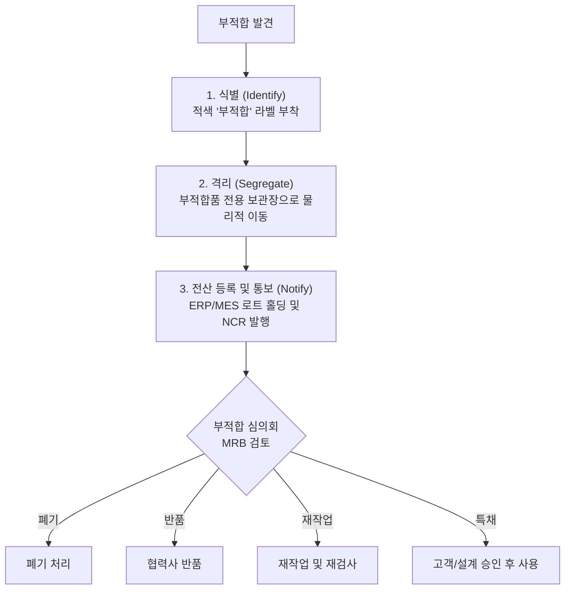

# 05. 부적합품 관리 및 시정조치 (NCR & CAPA)

품질관리에서 문제가 발생하는 것보다 더 중요한 것은 문제를 발견했을 때의 신속한 격리와 재발 방지입니다.

---

## 1. 부적합품 발생 시 즉각 대응 3원칙 (식별-격리-통보)



### 1) 식별 (Identify)
- 부적합이 확인된 즉시 해당 박스, 팔레트, 제품 본체에 **적색 부적합 라벨(HOLD/REJECT Tag)**을 부착합니다.
- 부적합 사유, 일자, 로트 번호, 수량, 검사원 이름을 명확히 기재합니다.

### 2) 격리 (Segregate)
- 양품과 섞이지 않도록 **노란색 안전 라인이 그어진 부적합품 보관 구역(잠금장치 구비)**으로 즉시 물리적 이동 조치합니다.

### 3) 전산 홀딩 및 통보
- MES/ERP 시스템에서 해당 로트를 `HOLD(출하/공정이동 금지)` 처리하여 물리적/시스템적 유출을 이중 차단합니다.
- 관련 부서(생산, 자재, 영업)에 즉시 NCR(부적합 보고서)을 발행하여 공유합니다.

---

## 2. 부적합 처리 심의회 (MRB - Material Review Board)

부적합품의 최종 처분은 검사원 1인의 임의 판단으로 결정되지 않으며, 품질, 생산, 설계, 기술 부서 합동 심의를 통해 결정됩니다.

- **폐기 (Scrap):** 재작업 불가능 또는 안전/기능상 치명적 결함일 때 폐기 처리
- **반품 (RTV - Return to Vendor):** 입고 자재 불량 시 구매팀을 통해 협력업체로 반송
- **재작업 (Rework):** 정해진 표준 재작업 절차(SOP)에 따라 수리 후 **전수 재검사** 진행
- **특채 / 양해 사용 (Concession / Use-As-Is):** 기능과 안전에 영향이 없다고 판단되어 설계/고객사의 공식 서면 승인을 득한 후 제한적 사용

---

## 3. 원인 분석 기법 (Root Cause Analysis)

문제의 겉보기 현상이 아닌 '근본 원인(Root Cause)'을 찾아내야 재발을 막을 수 있습니다.

### 1) 5-Why 분석법
- 현상에 대해 "왜(Why)?"를 연속 5회 이상 물어 시스템/관리적 원인까지 도달하는 기법
  - *현상: 나사가 헐겁게 조여져 조립 불량 발생*
  - Why 1: 왜 헐거웠는가? $\rightarrow$ 전동 드라이버 토크가 낮았음
  - Why 2: 왜 토크가 낮았는가? $\rightarrow$ 드라이버 세팅값이 변경되었음
  - Why 3: 왜 세팅이 바뀌었는가? $\rightarrow$ 작업자가 교체되면서 임의로 조작함
  - Why 4: 왜 임의 조작했는가? $\rightarrow$ 토크 조작 방지 락(Lock) 커버가 파손되어 있었음
  - Why 5: 왜 파손 상태로 방치되었는가? $\rightarrow$ 일일 설비 점검 체크리스트에 락 커버 점검 항목이 누락됨
  - **$\Rightarrow$ 근본 대책: 설비 점검표에 락 커버 점검 항목 추가 및 작업자 표준 교육**

### 2) 특성요인도 (Fishbone / Ishikawa Diagram)
- **4M1E** 관점에서 원인을 브레인스토밍:
  - **Man (사람):** 작업자 숙련도, 교육 이수 여부, 피로도
  - **Machine (설비/도구):** 계측기 오차, 지그 마모, 공압 흔들림
  - **Material (자재):** 원자재 Lot 편차, 보관 상태, 공급사 변경
  - **Method (방법):** 작업 지침서 불명확, 검사 주기 미흡
  - **Environment (환경):** 온습도, 조도, 작업장 진동 및 분진

---

## 4. 시정 및 예방조치 (CAPA / 8D Report) 절차

중대 품질 결함 또는 반복 불량 발생 시 CAPA(Corrective and Preventive Action)를 전개합니다.

```
[D1] TFT 팀 구성
  ↓
[D2] 문제의 명확한 정의 (5W2H)
  ↓
[D3] 긴급 봉쇄 조치 (재고 전수 선별 및 라인 점검)
  ↓
[D4] 근본 원인 도출 (5-Why, Fishbone)
  ↓
[D5] 영구 시정조치 계획 수립
  ↓
[D6] 시정조치 실행 및 검증
  ↓
[D7] 재발 방지 대책 (표준서 개정, 타 공정 수평 전개)
  ↓
[D8] 팀 보상 및 사후 유효성 평가 (3개월/6개월 추적 모니터링)
```
