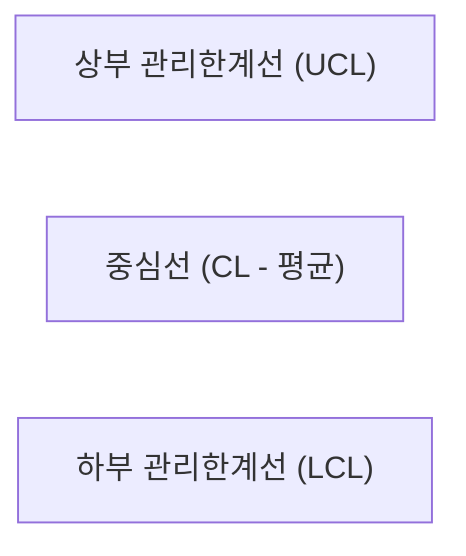

# 06. 데이터 분석 및 품질 지표 관리 (Metrics & SPC)

"측정할 수 없으면 관리할 수 없고, 관리할 수 없으면 개선할 수 없다."  
품질관리팀은 감이 아닌 통계와 데이터를 통해 공정의 능력을 정량화하고 모니터링합니다.

---

## 1. 핵심 품질 성과 지표 (KPI)

| 지표명 | 수식 / 산출 방식 | 의미 및 목표 관리 |
| :--- | :--- | :--- |
| **불량률 (Defect Rate)** | $\frac{\text{불량 수량}}{\text{총 검사 수량}} \times 100\ (\%)$ | 공정 및 출하 전반의 결함 발생 비율 |
| **PPM (Parts Per Million)** | $\frac{\text{불량 수량}}{\text{총 수량}} \times 1,000,000$ | 100만 개당 불량 개수 (고품질 양산 기준) |
| **직행률 (FTY / FPIR)** | $\frac{\text{재작업 없이 첫 회 통과 수량}}{\text{투입 수량}} \times 100\ (\%)$ | 공정의 낭비 없는 원류 품질 수준 |
| **공정능력지수 ($C_p, C_{pk}$)** | $C_p = \frac{USL - LSL}{6\sigma}$, $C_{pk} = (1-k)C_p$ | 규격 범위 대비 공정 산포 및 치우침 정도 |
| **고객 불만 건수 (Claim)** | 월간/분기별 고객사 VOC 및 반품 건수 | 시장 품질 및 최종 고객 만족도 |

---

## 2. 공정능력지수 ($C_{pk}$) 해석 기준

공정이 안정된 상태에서 제품 규격을 얼마나 잘 만족할 수 있는지를 나타내는 지수입니다.

- **$C_{pk} \ge 1.67$:** 특급 공정능력 (매우 우수, 6시그마 수준)
- **$1.33 \le C_{pk} < 1.67$:** 우수한 공정능력 (통상적인 양산 승인 목표치)
- **$1.00 \le C_{pk} < 1.33$:** 보통 공정능력 (규격 이탈 가능성 잠재, 주의 관리)
- **$C_{pk} < 1.00$:** 공정능력 부족 (불량 발생 필연적 $\rightarrow$ 긴급 공정 개선 필요)

---

## 3. 통계적 공정 관리 (SPC) 및 관리도 (Control Chart)

공정이 우연 원인(안정 상태)에 의한 변동인지, 이상 원인(조치 필요)에 의한 변동인지를 구분하는 도구입니다.

### 1) 대표 관리도 유형
- **계량형 관리도:** $\bar{X}-R$ 관리도 (시료군 평균 및 범위), $I-MR$ 관리도 (개별 측정치)
- **계수형 관리도:** $p$ 관리도 (불량률), $np$ 관리도 (불량개수), $c/u$ 관리도 (결점수)

### 2) 이상 판정 룰 (Western Electric Rules 요약)
관리한계선(UCL/LCL) 밖으로 점이 나가지 않더라도 다음 패턴이 보이면 공정에 이상이 있는 것으로 간주하고 조치해야 합니다:
1. **Rule 1 (1점 초과):** 관리한계선($3\sigma$) 밖으로 1개 점이 벗어남
2. **Rule 2 (연속 중심선 한쪽):** 연속 9개의 점이 중심선(CL)의 한쪽에 치우침
3. **Rule 3 (연속 증가/감소):** 연속 6개의 점이 지속적으로 상승하거나 하강 (공구 마모 등 의심)
4. **Rule 4 (교대 변동):** 연속 14개의 점이 상하로 교대로 널뜀

---

## 4. 사내 전산 시스템 및 분석 도구 활용

### 1) 시스템별 역할
- **ERP (SAP / 영림원 / 더존 등):**
  - 자재 입고 처리, 수입검사 판정 등록, 재고 상태(가용/보류/불량) 변경
- **MES (제조실행시스템):**
  - 실시간 설비 가동 현황, 공정 라우팅 추적, 바코드 스캔 데이터 연동
- **QMS (품질경영시스템) / LIMS:**
  - 부적합 보고서(NCR) 전자결재, CAPA 진행 현황, 계측기 교정 이력 관리

### 2) 통계 소프트웨어 (Excel, Minitab, Python 등)
- 데이터 입력 시 날짜, 로트, 작업자, 설비, 수치 등 **열(Column) 기준 원시 데이터(Raw data)** 형태로 축적
- 피벗 테이블(Pivot Table)을 이용한 공정별/불량 유형별 파레토 차트(Pareto Chart) 작성
  - *파레토 원칙 (80:20 법칙):* 전체 불량의 80%를 차지하는 상위 2~3개 불량 유형을 우선 타깃으로 집중 개선
