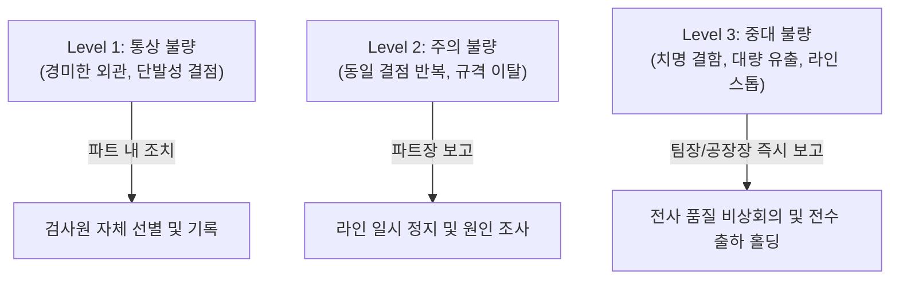

# 07. FAQ, 트러블슈팅 및 비상연락망 (FAQ & Contacts)

신규 입사자가 실무에서 직면하기 쉬운 난감한 상황에 대처하는 요령과 비상 연락망, 필수 용어 모음입니다.

---

## 1. 신규 담당자가 자주 묻는 FAQ 및 대응 요령

### Q1. 납기가 급하다고 생산/영업팀에서 검사 완료 전에 출하 승인을 요청합니다. 어떻게 해야 하나요?
> **답변:** **절대로 임의로 구두 승인하거나 서명해서는 안 됩니다.**  
> 품질 승인 없이 출하된 후 고객 불량이 발생하면 모든 책임이 검사원에게 집중됩니다.  
> *"규정상 검사 완료 및 시스템 승인 전에는 출하가 불가합니다. 급한 건이라면 품질팀장님/파트장님께 사전 긴급 검사 또는 특채 승인 검토를 요청해 주십시오"* 라고 정중히 규정을 설명하고 상급자에게 즉시 보고하세요.

### Q2. 치수가 규격 공차의 딱 경계선(Boundary)에 걸려 있습니다. 합격인가요 불합격인가요?
> **답변:** 
> 1. 계측기 영점 및 측정면의 이물질/온도를 재점검하고 **동일 시료를 재측정**합니다.
> 2. 가능하다면 정밀도가 한 단계 높은 상위 계측기(예: 버니어캘리퍼스 $\rightarrow$ 마이크로미터 또는 비접촉 2차원 측정기)로 재검증합니다.
> 3. 여전히 경계선상이라면 샘플 크기를 2배로 늘려 추가 샘플링을 진행하고, 선임 검사원 또는 파트장의 교차 검증을 받으세요.

### Q3. 생산 라인에서 불량이 지속적으로 나오는데 라인을 멈춰야 할까요?
> **답변:** 치명 결함(안전 위험, 법규 위반)이거나 동일 중결함이 연속 3개 이상 발생할 경우 **즉시 생산 라인 반장/조장에게 알리고 라인 인터락(Line Stop)을 요청**합니다. 동시에 품질 파트장/팀장에게 에스컬레이션 보고합니다.

---

## 2. 품질 이상 발생 시 비상 에스컬레이션 기준

---

## 3. 필수 품질 전문 용어집 (Glossary)

- **4M:** Man(사람), Machine(설비), Material(자재), Method(방법) - 생산을 구성하는 4대 기본 요소
- **5S:** 정리(Seiri), 정돈(Seiton), 청소(Seiso), 청결(Seiketsu), 습관화(Shitsuke)
- **AQL (Acceptable Quality Level):** 합격 품질 수준. 샘플링 검사에서 합격할 수 있는 최대 불량률
- **CAPA (Corrective and Preventive Action):** 시정 및 예방 조치
- **COA (Certificate of Analysis):** 품질 검사 성적서 / 분석 증명서
- **FMEA (Failure Mode and Effects Analysis):** 고장 형태 및 영향 분석 (설계 및 공정 잠재 위험 사전 평가)
- **NCR (Non-Conformance Report):** 부적합 보고서
- **PPAP (Production Part Approval Process):** 생산 부품 승인 절차 (양산 초도품 검증 체계)
- **RMA (Return Material Authorization):** 반품 승인 번호/절차
- **SOP (Standard Operating Procedure):** 표준 작업 지침서

---

## 4. 비상 연락망 및 유관 부서 안내

*(※ 입사 후 본인의 팀 내선 및 멘토 번호를 기입해 보관하세요)*

| 역할 / 부서 | 담당자 성명 | 사내 내선 | 비상 연락처 | 이메일 |
| :--- | :--- | :--- | :--- | :--- |
| **품질관리팀장** | 홍길동 | 1201 | 010-XXXX-XXXX | qc_lead@company.com |
| **품질 멘토 (선임)** | 김철수 | 1205 | 010-XXXX-XXXX | mentor_qc@company.com |
| **IQC 파트장** | 이영희 | 1207 | 010-XXXX-XXXX | iqc_part@company.com |
| **IPQC/OQC 파트장**| 박민수 | 1208 | 010-XXXX-XXXX | ipqc_part@company.com |
| **생산관리/현장사무실**| 최팀장 | 1300 | 010-XXXX-XXXX | prod_ctrl@company.com |
| **자재/창고 담당자**| 정과장 | 1400 | 010-XXXX-XXXX | warehouse@company.com |
| **공인 계측기 교정기관**| 한국계측기센터 | - | 02-XXX-XXXX | - |
