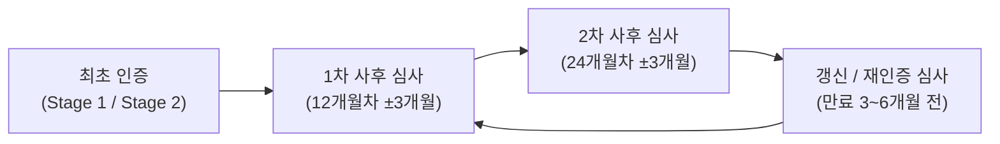
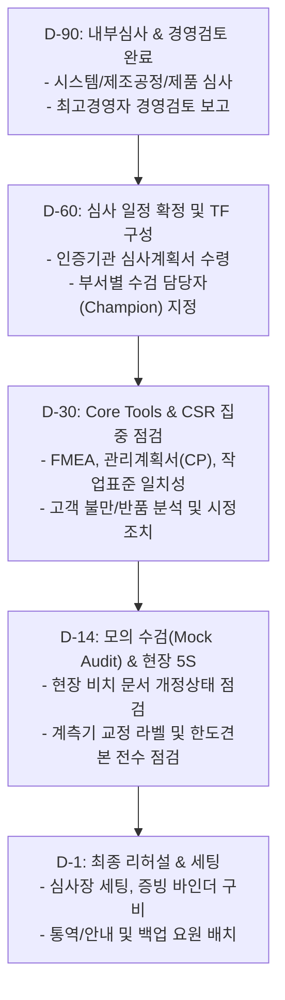
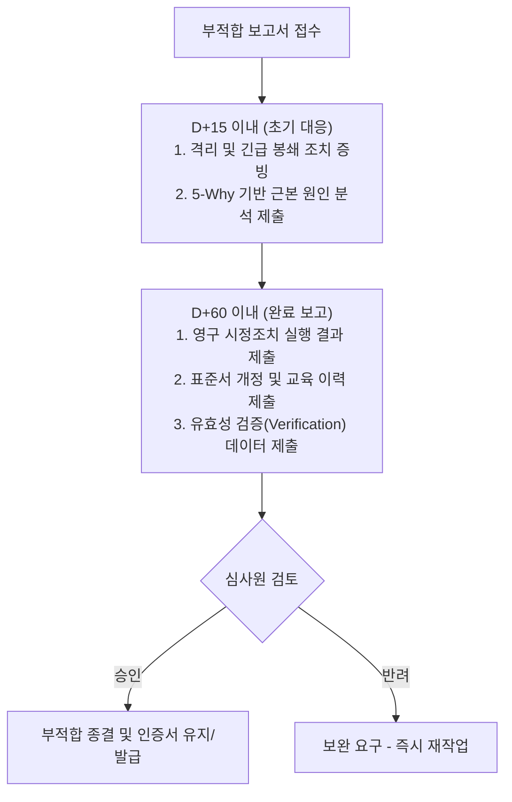

# 08. ISO 9001 및 IATF 16949 갱신·사후 심사 대응 프로세스 매뉴얼

본 문서는 품질경영시스템(ISO 9001) 및 자동차 품질경영시스템(IATF 16949)의 인증 유지, 정기 사후 심사(Surveillance Audit), 3년 주기 갱신 심사(Recertification Audit)를 체계적으로 준비하고 수검하기 위한 표준 대응 매뉴얼입니다.

---

## 1. 인증 심사 체계 및 주기 이해

### 1) 심사 주기 (3년 인증 사이클)

- **사후 심사 (Surveillance Audit):** 인증 취득 후 매년 1회 실시. 핵심 공정, QMS 유지 상태, 이전 심사 시정조치 유지 여부를 샘플링 점검.
- **갱신/재인증 심사 (Recertification Audit):** 인증 만료(3년) 전 진행. 최초 심사와 동등한 수준으로 전 조항 및 전 공정을 포괄적으로 심사.
- **IATF 16949 특화 요구사항:**
  - IATF 인증 규칙(Rules 6th Edition) 엄격 적용
  - 고객지정요구사항(CSR - Customer Specific Requirements) 준수 여부 필수 점검
  - 5대 코어 툴(Core Tools: APQP, FMEA, MSA, SPC, PPAP) 적용 실적 점검

---

## 2. 심사 준비 단계별 로드맵 (D-90 ~ D-Day)

### [D-90] 내부 심사 및 경영검토 (필수 선행 조건)
- IATF 16949 요구에 따라 3대 내부 심사를 연간 계획대로 완료해야 함:
  1. **QMS 시스템 심사:** 전 프로세스 위험 기반 심사
  2. **제조공정 심사 (VDA 6.3 기준 준용):** 입고부터 출하까지 전 라인 공정 감사
  3. **제품 심사 (VDA 6.5 기준 준용):** 포장 완료품에 대한 규격/치수/성능 전수 검증
- **경영검토(Management Review):** 최고경영자 주관 하에 품질 목표 달성률, 고객 불만, 시정조치 결과, 자원 적절성을 검토하고 회의록을 승인 완료해야 함.

### [D-60] 심사 일정 조율 및 수검 TF 발족
- 인증기관(DNV, BSI, TUV, KSR 등)으로부터 심사 계획서(Audit Plan) 수령
- 심사원별 동선 및 일정표(Matrix) 작성
- 프로세스 오너(팀장급) 및 실무 간사(대리~과장급) 지정

### [D-30] 5대 Core Tools 정합성 및 고객 요구사항(CSR) 점검
- **삼위일체 정합성 검증:** `DFMEA/PFMEA` $\leftrightarrow$ `관리계획서(Control Plan)` $\leftrightarrow$ `작업표준서(SOP)` $\leftrightarrow$ `검사기준서` 간의 특별특성(Special Characteristics, $\nabla$ 기호 등) 일치 여부 점검
- 고객 요구사항(CSR) 최신 개정판 반영 여부 및 고객 포털(Portal) 평가 점수(Scorecard) 점검

### [D-14 ~ D-1] 현장 환경 및 문서 최종 점검
- 제조 현장 내 폐기된 구버전 문서 비치 여부 점검 (발견 즉시 파기)
- 모든 계측기의 교정 만료일 점검 (만료 임박 기기는 즉시 교정 조치)
- 부적합품 격리 구역의 적색 태그, 시건장치 상태 점검
- 심사장 세팅 (빔프로젝터, 프린터, 음료, 주요 표준 바인더 사전 비치)

---

## 3. 심사 당일(D-Day) 현장 수검 프로토콜

### 1) 일일 진행 타임라인
1. **오프닝 미팅 (09:00):** 최고경영자 참석, 회사 소개, 심사 목적/범위 확인, 안전 유의사항 안내
2. **현장 및 부서별 심사:** 심사 계획서에 따른 인터뷰 및 샘플링 검증
3. **일일 중간 회고 (Daily Debriefing, 17:00):** 당일 발견된 관찰사항 및 잠재 부적합 공유
4. **클로징 미팅 (종료일 16:30):** 최종 심사 결과 발표, 부적합(NC) 보고서 서명

### 2) 수검자 필수 행동 수칙 (Do's & Don'ts)

| 구분 | 바람직한 행동 (Do) | 금지해야 할 행동 (Don't) |
| :--- | :--- | :--- |
| **답변 태도** | 질문의 요지만 명확하고 간결하게 답변 | 묻지 않은 배경까지 장황하게 부연 설명 (꼬투리 제공) |
| **증빙 제시** | 사내 규정(SOP)과 실제 발행된 데이터 기록으로 증명 | "늘 하던 방식입니다", "기억상 그렇습니다" 등 추측성 진술 |
| **서류 탐색** | 백업 지원조를 통해 **3분 이내**에 신속히 서류 제시 | 서류를 못 찾아 우왕좌왕하거나 10분 이상 지체 |
| **불명확한 점**| 질문이 애매할 경우 정중히 다시 묻고 확인 | 모르는 내용을 임의로 넘겨짚어 거짓 답변 |
| **지적 사항** | 객관적 결함은 솔직히 인정하고 개선 의지 피력 | 심사원과 감정적으로 논쟁하거나 변명 일관 |

### 3) 심사 대응 조편성 및 역할
- **동행 안내자 (Escort):** 심사원 곁에서 시간 관리 및 이동 경로 안내 (품질 파트장)
- **기록 및 메모 담당 (Scribe):** 심사원이 질의한 품번, 로트 번호, 지적 내용을 실시간 메신저방에 공유
- **백업 상황실 (Runner/Support):** 메신저로 요청된 서류/도면을 즉시 출력하여 심사 현장으로 조달

---

## 4. 심사 후 부적합(NC) 대응 및 CAR 발행 (IATF Rules 준수)

심사에서 부적합이 발행된 경우, 국제 공인 기한을 1일이라도 넘기면 인증이 정지(Suspension)될 수 있으므로 기한 준수가 절대적입니다.

### 1) 부적합의 등급
- **중부적합 (Major NC):**
  - QMS 시스템의 완전한 붕괴 또는 제품의 안전/기능에 치명적 영향을 미치는 상태
  - 미적용 고객 클레임 방치, 교정 미실시 계측기 사용 출하, 내부심사 미실시 등
  - *영향:* 90일 이내 현장 재심사(Special Audit) 요구 가능
- **경부적합 (Minor NC):**
  - 시스템은 수립되어 있으나 부분적인 작업자의 미준수 또는 단순 일회성 누락
  - 점검표 1~2건 서명 누락, 단순 라벨 미부착 등
- **기회/권고사항 (OFI - Opportunity for Improvement):**
  - 규격 위반은 아니나 향후 개선이 권장되는 사항 (차기 심사 시 개선 추적)

### 2) IATF CAR 작성 3대 핵심 포인트
1. **발생 원인(Occurence)과 유출 원인(Detection)의 분리:**
   - 왜 불량이 만들어졌는가? (공정적 원인)
   - 왜 검사 단계에서 거르지 못하고 유출되었는가? (품질검출 시스템 원인)
2. **시스템적 근본 원인:** "작업자 부주의"는 인정되지 않음 $\rightarrow$ 작업 지침서 불명확, 실수방지장치(Fool-Proof/Poka-Yoke) 미흡 등 시스템적 원인 제시
3. **수평 전개 (Look-Across / Read-Across):** 동일 또는 유사한 다른 제품 라인에도 동일한 개선 조치가 적용되었음을 증명

---

## 5. 부서별 핵심 수검 체크리스트

| 부서 | 핵심 확인 문서 및 질문 사항 | 주요 증빙 자료 |
| :--- | :--- | :--- |
| **최고경영진 / 기획** | - 품질방침 숙지 및 조직 상황(SWOT, 이해관계자 요구) 파악 - 경영검토 실시 실적 및 자원 지원 의지 | 경영검토 회의록, 사업계획서, 조직도 |
| **품질보증 / 관리** | - 내부심사 자격 부여 이력, 내부심사 결과 보고서 - 계측기 검교정 성적서 및 MSA(Gage R&R) 보고서 - 고객 불만 대응 8D Report 및 유효성 추적 기록 | 내부심사 보고서, MSA 계획/실적, 교정대장, CAPA 대장 |
| **개발 / 연구소** | - APQP / 신차 개발 게이트 단계별 산출물 - FMEA 최신 개정판(AIAG-VDA 통합본) 및 특별특성 관리 - 도면 설계 변경(ECR/ECO) 이력 및 승인 절차 | 개발 계획서, DFMEA, 도면 변경 이력, PPAP 승인서 |
| **구매 / 협력사품질**| - 협력업체 정기 평가 및 IATF/ISO 인증서 확보 현황 - 수입검사 부적합 발생 시 협력사 시정조치 요구 및 종결 관리 - 고객 지정 공급처(Directed Supplier) 관리 현황 | 공급자 평가표, 자재 수입검사 성적서, 협력사 SCAR |
| **생산 / 제조** | - 현장 작업표준서, 검사기준서, 한도견본 비치 상태 - 초/중/종물 검사 기록 및 4M 변경점 발생 시 초도품 검사 - 작업자 자격 인증(Skill Matrix) 및 교육 훈련 이력 | 제조일지, 초중종물 점검표, 4M 변경 신고서, 작업자 자격대장 |
| **설비 / 보전** | - 설비/금형 예방보전(PM) 연간 계획 대비 실적 - 설비 고장 시 MTBF/MTTR 지표 관리 및 개선 실적 - 주요 스페어 파트(예비품) 관리 및 보관 상태 | 예방보전 점검표, 금형 타발 이력, 스페어파트 대장 |
