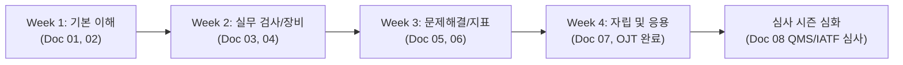

# 📋 품질관리팀(QC/QA) 온보딩 가이드

품질관리팀에 오신 것을 진심으로 환영합니다! 🎉  
본 문서는 신규 입사자 및 부서 이동자가 품질관리팀의 핵심 업무, 프로세스, 관련 규정 및 도구를 빠르게 이해하고 적응할 수 있도록 돕기 위해 구성된 온보딩 가이드입니다.

> 💡 **전체 문서 세트 소개 및 상황별 활용 가이드:** [문서_활용_가이드.md](./문서_활용_가이드.md)를 먼저 확인하시면 상황별로 필요한 문서를 빠르게 찾으실 수 있습니다.

---

## 🗂 온보딩 문서 체계 (총 8편)

아래 순서대로 문서를 읽고 실무에 적응해 나가시면 됩니다. 각 파일은 독립적인 주제를 다루며, 필요한 템플릿과 체크리스트가 포함되어 있습니다.

| 번호 | 문서명 | 주요 내용 |
| :---: | :--- | :--- |
| **01** | [01_팀_소개_및_역할.md](./01_팀_소개_및_역할.md) | 팀 비전, 미션, R&R(IQC/IPQC/FQC/QA), 첫 30일 로드맵 |
| **02** | [02_사내_품질_시스템_및_규정.md](./02_사내_품질_시스템_및_규정.md) | QMS 체계, ISO 표준, SOP 검색 및 문서 제/개정 절차 |
| **03** | [03_검사_프로세스_및_실무_가이드.md](./03_검사_프로세스_및_실무_가이드.md) | 수입/공정/출하 검사 절차, 샘플링 기준(AQL), 성적서 작성 |
| **04** | [04_품질_측정_장비_및_계측기_관리.md](./04_품질_측정_장비_및_계측기_관리.md) | 측정 장비 사용법, 검교정 주기 관리, 게이지 R&R, 안전 수칙 |
| **05** | [05_부적합_관리_및_시정조치_CAPA.md](./05_부적합_관리_및_시정조치_CAPA.md) | 부적합품 격리/식별, NCR 작성, 5-Why 원인분석, CAPA 절차 |
| **06** | [06_데이터_분석_및_품질_지표_관리.md](./06_데이터_분석_및_품질_지표_관리.md) | 핵심 KPI(Cpk, PPM, 수율), SPC 관리도, 사내 툴(ERP/MES/QMS) |
| **07** | [07_FAQ_트러블슈팅_및_비상연락망.md](./07_FAQ_트러블슈팅_및_비상연락망.md) | 실무 FAQ, 에스컬레이션 기준, 비상연락망, 필수 품질 용어집 |
| **08** | [08_ISO9001_IATF16949_심사대응_매뉴얼.md](./08_ISO9001_IATF16949_심사대응_매뉴얼.md) | 갱신/사후 심사 D-90 준비 로드맵, 심사 당일 프로토콜, IATF CAR 조치, 부서별 체크리스트 |

---

## 🧭 추천 온보딩 타임라인

> 💡 **Tip:** 각 문서의 `[ ] 체크박스` 항목을 멘토와 함께 하나씩 점검하며 진행하세요.
