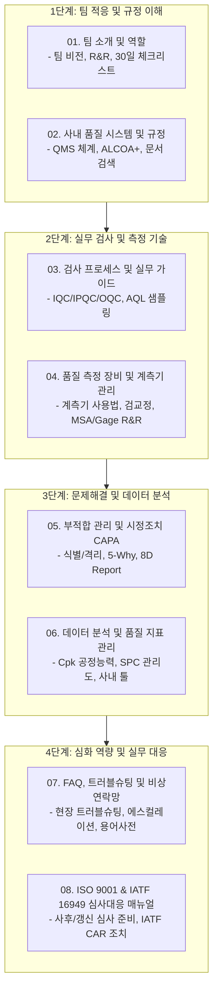

# 📖 품질관리팀 온보딩 문서 세트 설명서 및 활용 가이드 (Documentation Overview)

본 문서는 품질관리팀(QC/QA) 온보딩 문서 세트의 기획 목적, 대상 독자, 전체 문서 구조에 대한 상세 해설 및 상황별 활용법을 안내하는 종합 설명서입니다.

---

## 1. 문서 세트 개요 및 기획 의도

- **문서 목적:** 
  신규 입사자 및 부서 이동자가 복잡한 품질 규정과 현장 프로세스에 신속하고 체계적으로 적응할 수 있도록 지원하고, 품질 보증의 표준화를 달성하기 위함입니다.
- **적용 대상:**
  - 품질관리팀 신규 입사자 (IQC, IPQC, OQC, QA)
  - 타 부서에서 전입된 구성원
  - 신규 입사자의 OJT를 담당하는 품질 멘토 및 파트장

---

## 2. 챕터별 상세 설명 및 학습 목표

각 문서는 유기적으로 연결되어 있으며, 입사 첫날부터 독립 업무 수행 시점까지 단계별로 습득할 수 있도록 구성되어 있습니다.

### [01. 팀 소개 및 역할](./01_팀_소개_및_역할.md)
- **핵심 내용:** 품질관리팀의 3대 핵심 가치(원칙 준수, 예방 우선, 데이터 중심), 수입(IQC)/공정(IPQC)/출하(OQC)/품질보증(QA) 파트별 R&R 정의.
- **활용 포인트:** 첫 출근 1~4주 차 동안 달성해야 할 구체적인 마일스톤 체크리스트가 포함되어 있어 OJT 진행 현황표로 활용됩니다.

### [02. 사내 품질 시스템 및 규정](./02_사내_품질_시스템_및_규정.md)
- **핵심 내용:** 사내 QMS 문서 계층도(매뉴얼 $\rightarrow$ 절차서 $\rightarrow$ 지침서 $\rightarrow$ 기록 양식), 데이터 완전성 원칙(ALCOA+), 문서 제·개정 승인 절차.
- **활용 포인트:** 규정 검색 방법과 현장 비치 관리본 확인 기준을 학습하여 규정에 근거한 업무 습관을 형성합니다.

### [03. 검사 프로세스 및 실무 가이드](./03_검사_프로세스_및_실무_가이드.md)
- **핵심 내용:** 입고부터 출하까지의 3단계 검사 플로우, 국제 샘플링 검사 규격(AQL / KS Q ISO 2859-1), 결점 등급(치명/중/경결점) 구분, 한도견본(Limit Sample) 운용 기준.
- **활용 포인트:** 실제 검사성적서(COA) 작성 시 필수 기입 항목과 합격/불합격 판정 기준을 제공합니다.

### [04. 품질 측정 장비 및 계측기 관리](./04_품질_측정_장비_및_계측기_관리.md)
- **핵심 내용:** 버니어캘리퍼스, 마이크로미터, 하이트게이지, 2D/3D 측정기 사용법, 검교정 주기 및 만료 라벨 식별법, 게이지 R&R(%GRR) 판정 기준.
- **활용 포인트:** 측정 오차를 예방하고 검사실 5S 및 온습도 관리 기준을 준수하도록 안내합니다.

### [05. 부적합 관리 및 시정조치 CAPA](./05_부적합_관리_및_시정조치_CAPA.md)
- **핵심 내용:** 불량 발생 시 즉각 조치 3원칙(식별-격리-통보), 부적합 심의회(MRB) 처분 프로세스, 5-Why 및 특성요인도(Fishbone)를 통한 근본 원인 분석, 8D Report 작성 단계.
- **활용 포인트:** 부적합품의 유출을 원천 차단하고 재발 방지 대책을 체계적으로 수립하는 실무 표준서입니다.

### [06. 데이터 분석 및 품질 지표 관리](./06_데이터_분석_및_품질_지표_관리.md)
- **핵심 내용:** 핵심 KPI(불량률, PPM, 직행률 FTY), 공정능력지수($C_p, C_{pk}$) 해석, 통계적 공정 관리(SPC) 관리도 이상 판정 룰(Western Electric Rules), ERP/MES/파레토 분석 활용법.
- **활용 포인트:** 데이터를 기반으로 공정의 안정성을 모니터링하고 중점 개선 과제를 발굴하는 역량을 기릅니다.

### [07. FAQ, 트러블슈팅 및 비상연락망](./07_FAQ_트러블슈팅_및_비상연락망.md)
- **핵심 내용:** 실무 다빈도 딜레마(출하 승인 압박 대처, 경계선 공차 판정, 라인 스톱 기준), 3단계 비상 에스컬레이션 기준, 필수 품질 전문 용어집(4M, 5S, PPAP, FMEA 등).
- **활용 포인트:** 돌발 상황 발생 시 신입 담당자가 당황하지 않고 올바른 의사결정을 내릴 수 있는 행동 가이드를 제공합니다.

### [08. ISO 9001 및 IATF 16949 심사대응 매뉴얼](./08_ISO9001_IATF16949_심사대응_매뉴얼.md)
- **핵심 내용:** 3년 인증 사이클(사후 및 갱신 심사), D-90 준비 로드맵, 심사 당일 수검 프로토콜(Do's & Don'ts), IATF CAR 작성 기한(D+15, D+60) 및 부서별 핵심 수검 체크리스트.
- **활용 포인트:** 정기 심사 시즌 시 전사 수검 대응 매뉴얼로 직접 활용할 수 있는 실무 지침서입니다.

---

## 3. 상황별 맞춤 문서 탐색 매트릭스 (Quick Navigation)

| 현재 직면한 업무 상황 | 가장 먼저 확인해야 할 문서 | 보조 참고 문서 |
| :--- | :--- | :--- |
| **"입사 첫 주, 무엇부터 시작해야 할지 모를 때"** | [01. 팀 소개 및 역할](./01_팀_소개_및_역할.md) | [README.md](./README.md) |
| **"검사 성적서를 작성하거나 샘플링 수량을 정할 때"** | [03. 검사 프로세스 및 실무 가이드](./03_검사_프로세스_및_실무_가이드.md) | [04. 측정 장비 관리](./04_품질_측정_장비_및_계측기_관리.md) |
| **"현장에서 불량이 발견되어 긴급 조치가 필요할 때"** | [05. 부적합 관리 및 시정조치 CAPA](./05_부적합_관리_및_시정조치_CAPA.md) | [07. FAQ & 트러블슈팅](./07_FAQ_트러블슈팅_및_비상연락망.md) |
| **"공정능력($C_{pk}$)을 분석하거나 주간 보고를 작성할 때"**| [06. 데이터 분석 및 품질 지표 관리](./06_데이터_분석_및_품질_지표_관리.md) | [02. 사내 품질 시스템](./02_사내_품질_시스템_및_규정.md) |
| **"외부 인증기관(ISO/IATF) 정기 감사를 앞두고 있을 때"** | [08. 심사대응 매뉴얼](./08_ISO9001_IATF16949_심사대응_매뉴얼.md) | [05. 부적합 관리 CAPA](./05_부적합_관리_및_시정조치_CAPA.md) |

---

## 4. 멘토 및 관리자 활용 지침

1. **OJT 진도 체크:** 01번 문서의 주차별 체크리스트를 주간 1on1 면담 도구로 활용하십시오.
2. **현장 실습 병행:** 문서를 읽는 것에 그치지 않고, 03번과 04번 문서를 토대로 실제 계측기와 성적서 작성 실습을 병행하십시오.
3. **지속적인 문서 갱신:** 사내 규정이나 프로세스가 변경될 경우, 즉시 문서를 개정하여 최신성을 유지하십시오.
